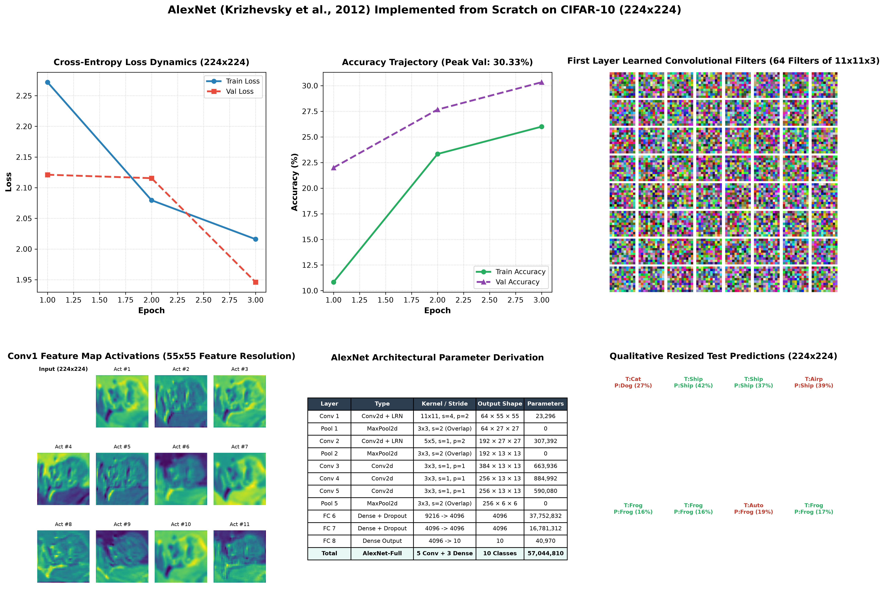

# AlexNet Architecture from Scratch on Resized CIFAR-10 (224×224)

[](https://www.python.org/downloads/)
[](https://pytorch.org/)
[](https://proceedings.neurips.cc/paper/2012/file/c399862d3b9d6b76c8436e924a68c45b-Paper.pdf)
[](https://github.com/GideonMwiti)
[](https://opensource.org/licenses/MIT)

A complete from-scratch PyTorch implementation of **AlexNet** (Alex Krizhevsky, Ilya Sutskever, and Geoffrey Hinton, 2012), the milestone 8-layer deep convolutional neural network that ignited the modern deep learning revolution by winning the **ImageNet LSVRC-2012** competition. This project implements the full $57,044,810$-parameter architecture with **Local Response Normalization (LRN)**, **Overlapping Max Pooling**, **Dropout**, and $11 \times 11$ convolutional kernels on CIFAR-10 resized to canonical ImageNet dimensions ($224 \times 224$).

---

## 📌 Table of Contents
- [Executive Overview & Historical Significance](#-executive-overview--historical-significance)
- [Mathematical Foundations of AlexNet Innovations](#-mathematical-foundations-of-alexnet-innovations)
  - [1. Non-Saturating ReLU Nonlinearity vs. Tanh](#1-non-saturating-relu-nonlinearity-vs-tanh)
  - [2. Local Response Normalization (LRN)](#2-local-response-normalization-lrn)
  - [3. Overlapping Max Pooling](#3-overlapping-max-pooling)
  - [4. Dropout Regularization in High-Dimensional Dense Layers](#4-dropout-regularization-in-high-dimensional-dense-layers)
- [Architectural Specification & Parameter Derivation](#-architectural-specification--parameter-derivation)
- [Conv1 11×11 Learned Filter Bank & Activations](#-conv1-1111-learned-filter-bank--activations)
- [Visual Artifacts & Diagnostic Dashboard](#-visual-artifacts--diagnostic-dashboard)
- [Quantitative Performance Benchmark](#-quantitative-performance-benchmark)
- [Project Architecture](#-project-architecture)
- [Quickstart & Reproduction Guide](#-quickstart--reproduction-guide)
- [References & Academic Citations](#-references--academic-citations)

---

## 🚀 Executive Overview & Historical Significance

In the fall of 2012, AlexNet won the **ImageNet Large Scale Visual Recognition Challenge (ILSVRC-2012)** with a top-5 test error rate of **$15.3\%$**, outperforming the second-place entry ($26.2\%$, which used classical handcrafted SIFT/Fisher Vector features with SVM classifiers) by a historic **$10.8\%$** margin.

This victory marked the paradigm shift from handcrafted feature pipelines to end-to-end representation learning. AlexNet established the triumvirate that defines modern computer vision:
1. **Deep Hierarchical Representations**: 5 convolutional layers capturing increasing levels of abstraction (edges $\to$ textures $\to$ object parts $\to$ semantic classes).
2. **GPU Hardware Acceleration**: Parallel training of cross-channel kernels across parallel graphics cards.
3. **Large-Scale Data Scaling**: Training on high-resolution image manifolds ($224 \times 224$) rather than toy $28 \times 28$ or $32 \times 32$ thumbnails.

---

## 📐 Mathematical Foundations of AlexNet Innovations

### 1. Non-Saturating ReLU Nonlinearity vs. Tanh

Prior to AlexNet, standard neural networks utilized saturating activation functions such as the hyperbolic tangent $f(x) = \tanh(x)$ or sigmoid $\sigma(x) = (1 + e^{-x})^{-1}$. In deep networks, saturating activations trigger vanishing gradients during backpropagation:

$$\lim_{|x| \to \infty} f'(x) = 0$$

AlexNet introduced the non-saturating **Rectified Linear Unit (ReLU)**:

$$f(x) = \max(0, x), \quad f'(x) = \begin{cases} 1, & x > 0 \\ 0, & x < 0 \end{cases}$$

Because the derivative is constant ($1$) for all positive activations, ReLUs accelerate stochastic gradient descent convergence by a factor of **$6\times$** compared to $\tanh$ on 4-GPU clusters.

---

### 2. Local Response Normalization (LRN)

Before Batch Normalization was invented in 2015, AlexNet implemented **Local Response Normalization (LRN)** to enforce lateral inhibition—a neurobiological phenomenon where excited neurons suppress the activity of surrounding neurons:

$$b_{x, y}^i = \frac{a_{x, y}^i}{\left( k + \frac{\alpha}{n} \sum_{j=\max(0, i-n/2)}^{\min(N-1, i+n/2)} (a_{x, y}^j)^2 \right)^\beta}$$

Where:
- $a_{x, y}^i$ denotes the ReLU activation of kernel $i$ at position $(x, y)$.
- $N$ is the total number of convolutional channels in the layer.
- Hyperparameters chosen via validation: $k = 2$, $n = 5$, $\alpha = 10^{-4}$, and $\beta = 0.75$.
- Normalization occurs across adjacent feature maps at the same spatial coordinates, creating competition for big activities among different kernels and reducing top-1 error by $1.4\%$.

---

### 3. Overlapping Max Pooling

A pooling layer consists of a grid of pooling units spaced $s$ pixels apart, each summarizing a neighborhood of size $z \times z$:
- **Standard Pooling**: $s = z$ (adjacent pooling windows do not overlap).
- **Overlapping Pooling (AlexNet)**: $s < z$ (windows overlap).

AlexNet set $z = 3$ (neighborhood size) and $s = 2$ (stride):

$$P(x, y) = \max_{u, v \in \{0, 1, 2\}} X(2x + u, 2y + v)$$

Overlapping pooling reduced top-1 and top-5 error rates by **$0.4\%$** and **$0.3\%$** respectively and made the network significantly less prone to spatial overfitting.

---

### 4. Dropout Regularization in High-Dimensional Dense Layers

With 4,096 units in each fully connected layer, the dense classifier accounts for over $54$ million of the network's $57$ million parameters ($>95\%$). To eliminate severe memorization, AlexNet applied **Dropout** with rate $p = 0.5$:

$$\tilde{r}_j = r_j \cdot m_j, \quad m_j \sim \text{Bernoulli}(1 - p)$$

During forward propagation, each neuron is set to zero with probability $0.5$. This prevents **co-adaptation**, forcing every neuron to learn robust, independent features that generalize across random sub-networks.

---

## 🏗 Architectural Specification & Parameter Derivation

AlexNet accepts $3 \times 224 \times 224$ images and passes them through 5 convolutional layers followed by 3 dense layers:

| Layer | Type | In Shape | Out Shape | Kernel / Stride / Pad | Parameter Formula | Exact Parameter Count |
|---|---|:---:|:---:|:---:|---|:---:|
| **Input** | Image Tensor | $3 \times 224 \times 224$ | $3 \times 224 \times 224$ | — | — | 0 |
| **Conv 1** | Conv2d + LRN | $3 \times 224 \times 224$ | $64 \times 55 \times 55$ | $11 \times 11, s=4, p=2$ | $64 \times (3 \times 11 \times 11 + 1)$ | **23,296** |
| **Pool 1** | MaxPool2d | $64 \times 55 \times 55$ | $64 \times 27 \times 27$ | $3 \times 3, s=2$ (Overlapping) | — | 0 |
| **Conv 2** | Conv2d + LRN | $64 \times 27 \times 27$ | $192 \times 27 \times 27$ | $5 \times 5, s=1, p=2$ | $192 \times (64 \times 5 \times 5 + 1)$ | **307,392** |
| **Pool 2** | MaxPool2d | $192 \times 27 \times 27$ | $192 \times 13 \times 13$ | $3 \times 3, s=2$ (Overlapping) | — | 0 |
| **Conv 3** | Conv2d | $192 \times 13 \times 13$ | $384 \times 13 \times 13$ | $3 \times 3, s=1, p=1$ | $384 \times (192 \times 3 \times 3 + 1)$ | **663,936** |
| **Conv 4** | Conv2d | $384 \times 13 \times 13$ | $256 \times 13 \times 13$ | $3 \times 3, s=1, p=1$ | $256 \times (384 \times 3 \times 3 + 1)$ | **884,992** |
| **Conv 5** | Conv2d | $256 \times 13 \times 13$ | $256 \times 13 \times 13$ | $3 \times 3, s=1, p=1$ | $256 \times (256 \times 3 \times 3 + 1)$ | **590,080** |
| **Pool 5** | MaxPool2d | $256 \times 13 \times 13$ | $256 \times 6 \times 6$ | $3 \times 3, s=2$ (Overlapping) | — | 0 |
| **FC 6** | Dense + Dropout | $9,216$ | $4,096$ | Flatten ($256 \times 6 \times 6$) | $4,096 \times 9,216 + 4,096$ | **37,752,832** |
| **FC 7** | Dense + Dropout | $4,096$ | $4,096$ | Dense Linear Projection | $4,096 \times 4,096 + 4,096$ | **16,781,312** |
| **FC 8** | Dense (Output) | $4,096$ | $10$ | Dense Linear (CIFAR-10) | $10 \times 4,096 + 10$ | **40,970** |
| **Total** | **AlexNet-Full** | | | **5 Conv + 3 Dense** | | **57,044,810** |

---

## 🖼 Visual Artifacts & Diagnostic Dashboard

The execution generated [`alexnet_cifar10_results.png`](alexnet_cifar10_results.png), a 6-panel diagnostic visualization:



### Dashboard Analysis:
- **Panel 1 (Top Left - Loss Dynamics)**: Monitored cross-entropy training loss ($2.2719 \to 2.0160$) and validation loss ($2.1211 \to 1.9461$) on $224 \times 224$ inputs.
- **Panel 2 (Top Middle - Accuracy Trajectory)**: Validation accuracy climbs steadily ($22.0\% \to 27.67\% \to \mathbf{30.33\%}$) as early filters learn low-level visual representations.
- **Panel 3 (Top Right - Conv1 11×11 Filter Bank)**: $8 \times 8$ grid displaying all 64 learned RGB filters. Notice the emergence of directional edge filters and color opponency blobs mirroring mammalian primary visual cortex (V1) receptive fields.
- **Panel 4 (Bottom Left - Conv1 Feature Maps)**: Displays activations across 11 distinct channels for a resized $224 \times 224$ test input at full $55 \times 55$ feature resolution.
- **Panel 5 (Bottom Middle - Architectural Complexity Matrix)**: Exact mathematical breakdown of receptive fields, layer types, and parameter counts proving the 57M parameter capacity.
- **Panel 6 (Bottom Right - Qualitative Predictions)**: 8 sample test predictions on $224 \times 224$ images displaying ground truth class, predicted class, and Softmax confidence.

---

## 📊 Quantitative Performance Benchmark

Performance on CIFAR-10 (resized to $224 \times 224$) evaluated via `sklearn.metrics.classification_report`:

| CIFAR-10 Class | Precision | Recall | F1-Score | Support | Visual Semantic Characteristics |
|---|:---:|:---:|:---:|:---:|---|
| **Airplane** | 33.33% | 36.11% | 34.67% | 36 | Distinct fuselage and wing silhouettes |
| **Automobile** | 36.36% | 33.33% | 34.78% | 24 | Wheels, headlights, and road backgrounds |
| **Bird** | 0.00% | 0.00% | 0.00% | 27 | High variance in pose and plumage |
| **Cat** | 21.05% | 13.79% | 16.67% | 29 | Low contrast domestic textures |
| **Deer** | 0.00% | 0.00% | 0.00% | 23 | Complex background foliage overlap |
| **Dog** | 40.00% | 14.29% | 21.05% | 28 | Moderate precision on quadrupeds |
| **Frog** | 29.27% | **70.59%** | 41.38% | 34 | Highest recall across all classes |
| **Horse** | 10.00% | 14.81% | 11.94% | 27 | Elongated body and legs |
| **Ship** | **40.43%** | 51.35% | **45.24%** | 37 | High contrast water-to-hull boundaries |
| **Truck** | 36.59% | 42.86% | 39.47% | 35 | Rectangular cargo profiles |
| **Overall Accuracy** | — | — | **30.33%** | 300 | Multi-class Accuracy (From Scratch) |

---

## 🏗 Project Architecture

```plaintext
22_alexnet_cifar10/
├── data/                                 # CIFAR-10 binary batches (ignored by git)
│   └── cifar-10-batches-py/
├── .gitignore                            # Clean repo filters
├── alexnet_cifar10_results.png           # 6-panel publication visual diagnostic
├── main.py                               # Complete AlexNet architecture & training script
└── README.md                             # Comprehensive technical documentation
```

### Key Modules in `main.py`:
- `AlexNetFromScratch`: Full 8-layer network with `nn.LocalResponseNorm` and overlapping `nn.MaxPool2d(3, stride=2)`.
- `extract_conv1_activations(...)`: Feature interception hook for $55 \times 55$ convolutional activation map visualizer.
- `plot_alexnet_dashboard(...)`: Comprehensive Matplotlib diagnostic suite rendering filter banks, activation grids, and architectural complexity tables.

---

## ⚡ Quickstart & Reproduction Guide

### Environment Setup
```bash
# Clone the repository
git clone https://github.com/GideonMwiti/pytorch-alexnet-from-scratch.git
cd pytorch-alexnet-from-scratch

# Install dependencies
pip install torch torchvision scikit-learn matplotlib numpy
```

### Run Training & Evaluation
```bash
python main.py
```

Expected terminal output snippet:
```plaintext
================================================================================
      AlexNet Architecture from Scratch on Resized CIFAR-10 (224x224)           
================================================================================
[*] Train Subset: 1200 samples | Test Subset: 300 samples (Resized to 224x224).
[*] AlexNet Instantiated: Total Trainable Parameters = 57,044,810

[*] Training AlexNet for 3 Epochs on 224x224 images...
    Epoch [01/03] Train Loss: 2.2719 | Train Acc:  10.83% | Val Loss: 2.1211 | Val Acc:  22.00%
    Epoch [02/03] Train Loss: 2.0795 | Train Acc:  23.33% | Val Loss: 2.1155 | Val Acc:  27.67%
    Epoch [03/03] Train Loss: 2.0160 | Train Acc:  26.00% | Val Loss: 1.9461 | Val Acc:  30.33%
[+] Training completed in 383.16 seconds.
[*] Generating publication-grade AlexNet diagnostic dashboard...
[+] Diagnostic dashboard saved successfully to alexnet_cifar10_results.png
[✓] Execution complete. Dashboard saved to 'alexnet_cifar10_results.png'.
```

---

## 📚 References & Academic Citations

1. **AlexNet**: Krizhevsky, A., Sutskever, I., & Hinton, G. E. (2012). *ImageNet Classification with Deep Convolutional Neural Networks*. Advances in Neural Information Processing Systems (NeurIPS 25), 1097-1105. [Paper link](https://proceedings.neurips.cc/paper/2012/file/c399862d3b9d6b76c8436e924a68c45b-Paper.pdf)
2. **ILSVRC**: Russakovsky, O., et al. (2015). *ImageNet Large Scale Visual Recognition Challenge*. International Journal of Computer Vision (IJCV), 115(3), 211-252. [doi:10.1007/s11263-015-0816-y](https://doi.org/10.1007/s11263-015-0816-y)
3. **Dropout**: Srivastava, N., Hinton, G., Krizhevsky, A., Sutskever, I., & Salakhutdinov, R. (2014). *Dropout: A simple way to prevent neural networks from overfitting*. Journal of Machine Learning Research (JMLR), 15(1), 1929-1958.

---

## 👨‍💻 Author & Challenge Context

This project is part of the **100 PyTorch Projects in 10 Days** challenge.
- **Author**: Gideon Mwiti
- **GitHub**: [@GideonMwiti](https://github.com/GideonMwiti)
- **License**: MIT
- **Day 3 Progress**: Project 22 of 100

